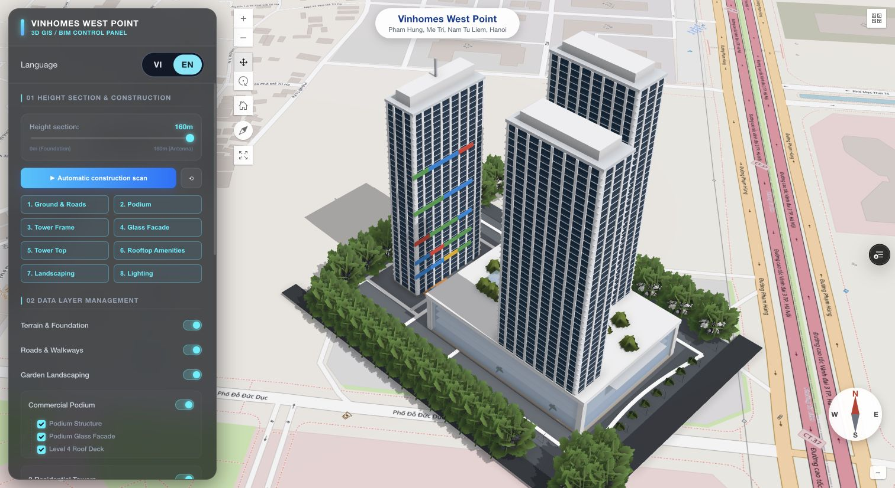

<div align="center">

# 🏙️ Vinhomes West Point · 3D GIS

### Explore the city in 3D. Manage the community in one place.

[](https://3d-geographic-information-system.vercel.app)
[](https://developers.arcgis.com/javascript/)


**[🚀 Open website](https://3d-geographic-information-system.vercel.app)**
&nbsp; · &nbsp;
**[🗺️ Explore 3D](https://3d-geographic-information-system.vercel.app/index.html)**

</div>

---

[](https://3d-geographic-information-system.vercel.app/index.html)

## ✨ About the project

An academic **3D Geographic Information Systems** project combining an interactive model of **Vinhomes West Point, Hanoi** with a property management portal. The scene represents towers **W1, W2, W3**, the podium, roads, landscaping and rooftop amenities.


## 🧭 Features

| Feature | Description |
|---|---|
| 🏙️ **3D scene** | Explore towers, building layers and construction phases |
| 🗺️ **Map tools** | Switch basemaps, reset the view and inspect coordinates |
| 🏠 **Apartment status** | Filter apartments by tower, floor and occupancy status |
| 👥 **Management** | Role-based access for administrators, managers, staff and residents |
| 📋 **Operations** | Residents, contracts, invoices, maintenance and notifications |
| 💳 **VNPay sandbox** | QR checkout with server-side payment confirmation |
| 🌐 **VI / EN** | Switch language across pages and the 3D control panel |

> **Language preference:** English and Vietnamese are available throughout the interface. Your choice is saved in the browser and carried across pages.

## 🛠️ Technology

```text
Frontend     HTML · CSS · JavaScript · ArcGIS Maps SDK 4.30
Backend      Go 1.25 · Gin · GORM
Database     PostgreSQL
Hosting      Vercel (frontend) · Railway (backend)
Integration  VNPay PAY 2.1.0 — Sandbox
```

## 🗂️ Project structure

```text
├── index.html                  # Interactive 3D scene
├── pages/                      # Management and resident portal
├── css/                        # Portal, scene and language controls
├── js/
│   ├── app.js                  # ArcGIS scene and interaction
│   ├── i18n.js                 # English / Vietnamese localization
│   ├── api/                    # Backend API clients
│   ├── gis/                    # Apartment status overlay
│   └── towers/, podium/, ...   # Building geometry and scene modules
├── backend/
│   ├── cmd/                    # Server entry point
│   ├── config/                 # Environment configuration
│   ├── internal/               # Models, handlers and services
│   └── scripts/                # PostgreSQL integration tests
└── tests/                      # Frontend regression tests
```

## 🚀 Run locally

### 1. Backend

Requires **Go 1.25+** and **Docker** for the bundled PostgreSQL setup.

```sh
cd backend
cp config/.env.example config/.env
# Edit config/.env with your local settings.
./run.sh
```

The backend listens on `http://localhost:8080` by default. See [backend setup](backend/README.md) for details.

### 2. Frontend

From the repository root, serve the static files:

```sh
python3 -m http.server 5500
```

Open [local portal](http://localhost:5500/pages/login.html) or [local 3D model](http://localhost:5500/index.html). Localhost pages use the local backend automatically; hosted pages use Railway. To use another backend, configure `window.__API_BASE_URL` in `js/env-config.js`.

### 3. Run checks

```sh
node --test tests/*.test.mjs
cd backend
go test ./...
./scripts/test-integration.sh
```

The integration script starts and removes an isolated PostgreSQL test container.

## 💳 Payment setup

VNPay is currently configured for **sandbox testing**. Terminal approval and IPN registration are managed by VNPay. See [VNPay deployment notes](backend/VNPAY_DEPLOYMENT.md) for configuration and callback behavior. Keep credentials in environment variables.

## 📚 Academic context

Built for learning 3D GIS visualization and property management workflows. The model is an approximate representation, rather than a survey or construction reference.


---

<div align="center">

**[🏙️ Visit Vinhomes West Point 3D GIS](https://3d-geographic-information-system.vercel.app)**

</div>
